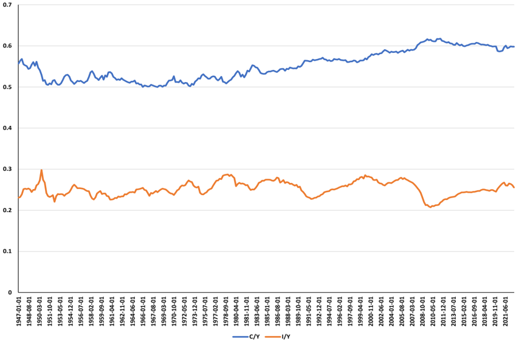
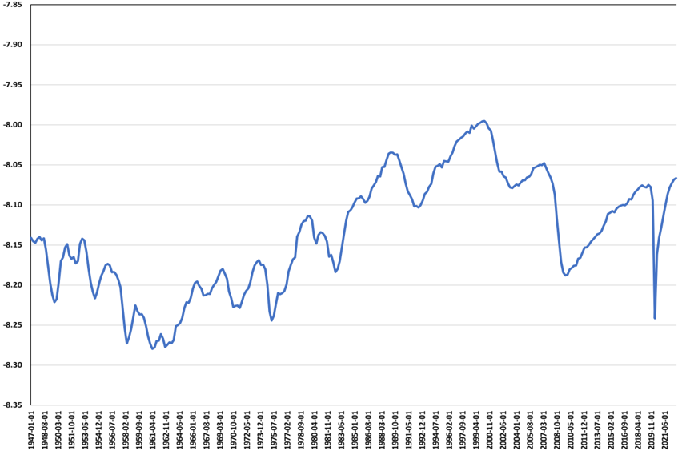
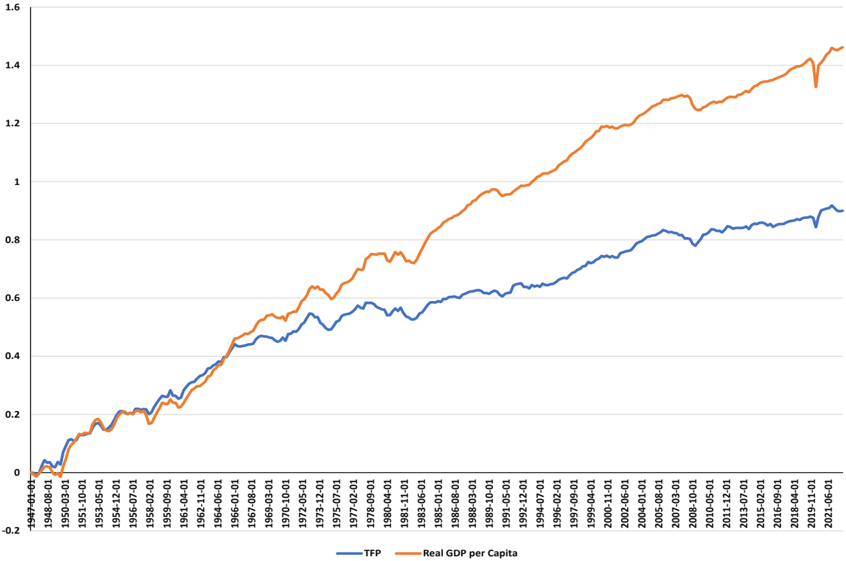
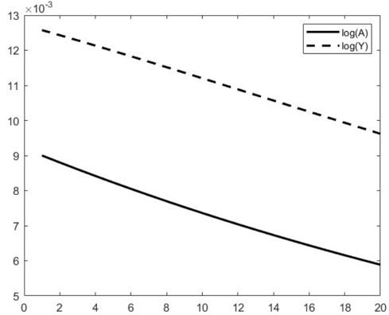
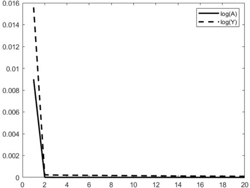

# Graduate Macro Theory II:

Business Cycle Facts and the Quantitative Performance of the RBC Model

Eric Sims

University of Notre Dame

Spring 2024

## 1 Introduction

This note describes some basic facts about US business cycles and then examines how well the basic RBC model can fit those facts.

## 2 Stylized US Business Cycle Facts

The convention within the literature is to look at cyclically detrended data to examine the business cycle. Historically, a very popular way to extract the cyclical component of variables is the HP filter, although there have recently been some critiques about this filter. For the purposes of this note, I will focus on deviations from the smooth HP trend. There are, of course, alternative ways in which one can look at the cyclical component of the data (e.g. first differences, the Band Pass filter, linear detrending, etc.).

"Business cycle moments" focus primarily on second moments. In particular, the standard deviation of a series is referred to as its volatility. We are also interested in looking at a series' cyclicality, which is defined as its contemporaneous correlation with GDP. We call the first order autocorrelation of a series a measure of its persistence, and we also look at how strongly a series is correlated with output led or lagged a number of periods, so as to say something about which series are "lagging indicators" and which series are "leading indicators".

The series we are most interested in looking at are the same endogenous variables that come out of a simple real business cycle model - output, consumption, investment, total hours worked, the real wage, and the real interest rate. In addition, we will look at average labor productivity (the ratio of output to total hours worked), the price level, and total factor productivity (TFP). The price level is not in the model as we have thus far specified it, but can easily by added. TFP is the empirical counterpart of the driving force $A_{t}$ in the model. We measure it as output minus share-weighted inputs:$$
\ln\widehat{A}_{t}=\ln Y_{t}-\alpha\ln K_{t}-(1-\alpha)\ln N_{t} \tag{1}
$$

Constructing this series requires an empirical measure of the capital stock. In practice, this is hard to measure and most existing capital stock series are only available at an annual frequency. Typically the way in which people measure the capital stock is by using the "perpetual inventory" method. This method essentially takes data on investment, an initial capital stock, and an estimate of the rate of depreciation $\delta$ and constructs a series using the accumulation equation for capital: $K_{t+1}=I_{t}+(1-\delta)K_{t}$.

It is very common to refer to "TFP shocks" in business cycle models. I try to avoid using this terminology. TFP is an _empirical construct_ that corresponds to the exogenous productivity variable in a model _assuming the production functional is correctly specified and inputs are accurately measured_. In practice, neither of these things are likely to be true.

All series (with the exception of TFP, the price level, and the interest rate) are expressed in per capita terms after dividing by the civilian non-institutionalized population aged 16 and over. All series are also in real terms (except the price level) and in logs (with the exception of the interest rate). The measure of GDP is the real GDP from the BEA accounts. The measure of consumption is the sum of non-durable and services consumption, also from the BEA accounts. Investment is measured as total private fixed investment plus consumption expenditures on durable goods (durable goods should be thought of as investment because they provide benefits in the future, just like new physical capital does). Consumption and investment data are from the BEA. Total hours is measured as total hours in the non-farm business sector, available from the BLS. Average labor productivity is output per hour in the non-farm business sector, also from the BLS. Wages are measured as real compensation per hour in the non-farm business sector, from the BLS. The price level is measured as the implicit price deflator for GDP, from the BEA. The nominal interest rate is measured as the three month Treasury Bill rate. The real interest rate is approximately $r_{t}=i_{t}-E_{t}\pi_{t+1}$. I construct a measure of the ex-post real interest rate using the measured T-bill rate at time $t$ and actual inflation from $t$ to $t+1$, where inflation is measured from the GDP deflator. This is ex-post because actual will not equal expected inflation in general.[^1] Before looking at cyclical detrended series, it is helpful to plot a few raw series. First, I plot the ratios of consumption-output and investment-output. These are shown in the graph below. These ratios are more or less stable - consumption between 50-60 percent of output and investment around 25 percent of output. If anything, the consumption-output ratio has gone up a bit. But, the more or less constancy of these ratios (over long periods of time) is consistent with balanced growth.

Next, I plot hours per capita. Note that the units being negative doesn't mean anything since I am plotting this in logs. Hours per capita is also more or less constant over long periods of time. The apparent stationarity of hours worked is an important fact that preferences need to match. One can clearly see large swings in hours worked around the time of recessions (the short-lived COVID recession is particularly noteworthy in this regard).

Figure 1: Consumption-Output and Investment-Output Ratios

Finally, I plot the log levels of TFP and real GDP per capita. I normalize both to equal zero at the beginning of the sample. GDP grows faster than TFP on average. In a neoclassical growth model along a balanced growth path with Cobb-Douglas preferences, GDP ought to grow about 1.5 times as fast as TFP (this is equal to $(1-\alpha)^{-1}$ with a Cobb-Douglas production function with $\alpha$ equaling capital's share of income; so with $\alpha=1/3$ we get this factor being $3/2$). This is roughly consistent with the data, with output at the end of the sample 1.6 times as big as TFP.

Figure 2: Hours per Capita

Next, I move away from long-run properties and focus on short-run properties of the data. To do so, I HP-filter all series (smoothing parameter of 1600) and calculate moments of HP-detrended data. The data are from 1947 quarter 1 to 2022 quarter 3. The selected moments are shown below.

The standard deviation of output is about 1.7 percent. Consumption is about two-thirds as volatile, and investment about 2.5 times as volatile as output. The standard deviation of hours worked is higher than that of output. The real interest rate, price level, and TFP are less volatile

\begin{table}
\begin{tabular}{l|l l l l l l} \hline \hline Series & Std. Dev. & Rel. Std. Dev. & Corr w/ $y_{t}$ & Autocorr & Corr w/ $Y_{t-4}$ & Corr w/ $Y_{t+4}$ \\ \hline Output & 0.0166 & 1.0000 & 1.0000 & 0.7878 & 0.0813 & 0.0813 \\ Consumption & 0.0110 & 0.6602 & 0.7550 & 0.6691 & 0.1548 & 0.0188 \\ Investment & 0.0444 & 2.6675 & 0.7593 & 0.8572 & -0.0511 & 0.2269 \\ Hours & 0.0211 & 1.2677 & 0.8669 & 0.8198 & 0.2763 & -0.0584 \\ Avg. Labor Productivity & 0.0114 & 0.6876 & 0.2721 & 0.6957 & -0.4485 & 0.3437 \\ Wage & 0.0115 & 0.6943 & -0.0129 & 0.7082 & -0.1050 & 0.1739 \\ Real Rate & 0.0043 & 0.2568 & -0.0020 & 0.4729 & 0.2711 & -0.2825 \\ Price Level & 0.0096 & 0.5798 & -0.0841 & 0.9072 & 0.1358 & -0.4357 \\ TFP & 0.0127 & 0.7626 & 0.7789 & 0.7639 & -0.2959 & 0.3058 \\ \hline \end{tabular}
\end{table}
Table 1: HP-Filtered Business Cycle Moments, Full Sample

Figure 3: TFP and Real GDP per Capita

than output. In terms of cyclicalities (correlations with output), consumption, investment, and hours are highly procyclical. Average labor productivity is weakly procyclical. The wage and real interest rate are basically acyclical. The price level is slightly countercyclical. TFP is strongly procyclical. All series are highly persistent, in the sense of having relatively large autocorrelation coefficients. Investment, TFP, and productivity are leading indicators - high values of these predict high values of cyclically detrended output a year ahead.

If you compare these moments with those presented in King and Rebelo (2000) ([https://www.kellogg.northwestern.edu/faculty/rebelo/htm/rbc2000.pdf,see](https://www.kellogg.northwestern.edu/faculty/rebelo/htm/rbc2000.pdf,see) Table 1), there are some differences. The relative standard deviations of consumption and investment are similar, as are their cyclicalities. But there are a couple of notable differences. First, the relative volatility of hours is higher. Second, the correlations of average labor productivity and the real wage are lower in what I am showing than what they have. Third, the real rate is not as countercyclical.

It turns out that, over the last 30 or so years, there have been some importance changes in business cycle moments. The next table shows the same moments, but from a sample running from 1947 through the end of 1983. There is an important phenomenon called the "Great Moderation" - after the early-1980s, most macro variables are less volatile.

The numbers in this table line up closer with those in King and Rebelo. Average labor productivity and the real wage are more strongly correlated with output, and the real interest rate is more countercyclical. Further, hours and output are about as volatile as one another.

Consider next the same moments, but on a sample post-1984 (through the present). See the table below.

\begin{table}
\begin{tabular}{l|l l l l l l} \hline \hline Series & Std. Dev. & Rel. Std. Dev. & Corr w/ $y_{t}$ & Autocorr & Corr w/ $Y_{t-4}$ & Corr w/ $Y_{t+4}$ \\ \hline Output & 0.0190 & 1.0000 & 1.0000 & 0.8205 & -0.0173 & -0.0173 \\ Consumption & 0.0092 & 0.4844 & 0.7249 & 0.7960 & 0.1630 & 0.0175 \\ Investment & 0.0490 & 2.5814 & 0.7113 & 0.8159 & -0.2681 & 0.1241 \\ Hours & 0.0196 & 1.0303 & 0.8856 & 0.8696 & 0.2174 & -0.2193 \\ Avg. Labor Productivity & 0.0123 & 0.6494 & 0.5722 & 0.6349 & -0.5153 & 0.3834 \\ Wage & 0.0080 & 0.4233 & 0.3153 & 0.7108 & -0.1880 & 0.2507 \\ Real Rate & 0.0052 & 0.2716 & -0.1122 & 0.4189 & 0.2341 & -0.3338 \\ Price Level & 0.0117 & 0.6163 & -0.1631 & 0.8881 & 0.2269 & -0.4708 \\ TFP & 0.0146 & 0.7671 & 0.8435 & 0.7581 & -0.3632 & 0.2110 \\ \hline \end{tabular}
\end{table}
Table 2: HP-Filtered Business Cycle Moments, Pre-1984 SampleWe see the so-called Great Moderation in action: the volatility of output (0.0126) is _significantly lower_ than in the earlier sample. We also see that the relative volatility of consumption is much higher (though this is mostly driven by COVID-19; if I omit the COVID period, the relative volatility of consumption is 0.7). Hours worked is much more volatile relative to output. Average labor productivity and the real wage are countercyclical in in the later sample, and the real rate is actually procyclical (as is the price level). These moments have changed quite a bit. This is important. As we shall see, the RBC model better fits data properties from the earlier sample. Its fit is much worse post-1984.

## 3 The Basic RBC Model and Calibration

The basic RBC model can be characterized by the first order conditions of the decentralized model, as described in class. These first order conditions are:

$$
u^{\prime}(C_{t})=\beta\mathbb{E}_{t}\left(u^{\prime}(C_{t+1})(R_{ t+1}^{k}+(1-\delta)\right) \tag{2}
$$ $$
v^{\prime}(1-N_{t})=u^{\prime}(C_{t})w_{t}
$$ (3) $$
K_{t+1}=A_{t}F(K_{t},N_{t})-C_{t}+(1-\delta)K_{t}
$$ (4) $$
\ln A_{t}=\rho\ln A_{t-1}+s_{A}\varepsilon_{t}
$$ (5) $$
Y_{t}=A_{t}F(K_{t},N_{t})
$$ (6) $$
Y_{t}=C_{t}+I_{t}
$$ (7) $$
u^{\prime}(C_{t})=\beta\mathbb{E}_{t}u^{\prime}(C_{t+1})(1+r_{t})
$$ (8) $$
w_{t}=A_{t}F_{N}(K_{t},N_{t})
$$ (9) $$
R_{t}^{k}=A_{t}F_{K}(K_{t},N_{t}) \tag{10}
$$

I use the functional form assumptions that $u(C_{t})=\ln C_{t}$, $v(1-N_{t})=\theta\ln(1-N_{t})$, and

\begin{table}
\begin{tabular}{l|l l l l l l} \hline \hline Series & Std. Dev. & Rel. Std. Dev. & Corr w/ $y_{t}$ & Autocorr & Corr w/ $Y_{t-4}$ & Corr w/ $Y_{t+4}$ \\ \hline Output & 0.0126 & 1.0000 & 1.0000 & 0.6545 & 0.1137 & 0.1137 \\ Consumption & 0.0122 & 0.9687 & 0.8679 & 0.5795 & 0.0531 & -0.1053 \\ Investment & 0.0365 & 2.9024 & 0.8057 & 0.8972 & 0.1959 & 0.3029 \\ Hours & 0.0216 & 1.7151 & 0.8941 & 0.7629 & 0.3024 & 0.0507 \\ Avg. Labor Productivity & 0.0103 & 0.8154 & -0.2902 & 0.7516 & -0.4587 & 0.1510 \\ Wage & 0.0136 & 1.0779 & -0.3089 & 0.6842 & -0.1228 & 0.1700 \\ Real Rate & 0.0032 & 0.2579 & 0.2736 & 0.6062 & 0.4788 & -0.1035 \\ Price Level & 0.0067 & 0.5284 & 0.3490 & 0.9184 & 0.2617 & -0.1795 \\ TFP & 0.0096 & 0.7649 & 0.5931 & 0.7171 & -0.3844 & 0.3939 \\ \hline \end{tabular}
\end{table}
Table 3: HP-Filtered Business Cycle Moments, Post-1984 Sample$F(K_{t},N_{t})=K_{t}^{\alpha}N_{t}^{1-\alpha}$. These first order conditions can then be re-written imposing these function forms to get:

$$
\frac{1}{C_{t}}=\beta\mathbb{E}_{t}\left(\frac{1}{C_{t+1}}\left(R_ {t+1}^{k}+(1-\delta)\right)\right) \tag{11}
$$ $$
\frac{\theta}{1-N_{t}}=\frac{1}{C_{t}}w_{t}
$$ (12) $$
K_{t+1}=A_{t}K_{t}^{\alpha}N_{t}^{1-\alpha}-C_{t}+(1-\delta)K_{t}
$$ (13) $$
\ln A_{t}=\rho\ln A_{t-1}+\varepsilon_{t}
$$ (14) $$
Y_{t}=A_{t}K_{t}^{\alpha}N_{t}^{1-\alpha}
$$ (15) $$
Y_{t}=C_{t}+I_{t}
$$ (16) $$
\frac{1}{C_{t}}=\beta\mathbb{E}_{t}\frac{1}{C_{t+1}}(1+r_{t})
$$ (17) $$
w_{t}=(1-\alpha)A_{t}K_{t}^{\alpha}N_{t}^{-\alpha}
$$ (18) $$
R_{t}^{k}=\alpha A_{t}K_{t}^{\alpha-1}N_{t}^{1-\alpha} \tag{19}
$$

We can solve for the steady state of the model as we have before. In the non-stochastic steady state we set $A_{t}$ equal to its non-stochastic mean, which is 1 (0 in the log). Let variables without time subscripts denote steady states.

In macroeconomics "calibration" is a particular way to choose parameter values. The gist of the calibration approach is to pick parameters so that the steady state of the model matches certain long run (i.e. average) features of the data. One of the novelties of the RBC approach (and with its calibration) was that it took a model that was (a) designed to explain the "long run" and (b) pick parameters designed to explain the "long run" but then (c) used that model and those parameters to explain the short run. You can think about the long run properties of the data as "identifying" the parameters of the model while short run moments are "overidentifying" restrictions which we can use to "test" the model. I put all these terms in quotations marks because we are not formally doing any of these things, but loosely this is what we are doing when we calibrate the model.

Let's begin by coming up with a value for $\beta$. Go to the Euler equation for risk-free bonds. Evaluated in steady state, it implies:

$$
\beta=\frac{1}{1+r} \tag{20}
$$

In the data the average real interest rate on riskless debt can be measures as $r=i-\pi$, where $i$ is a "safe" nominal interest rate and $\pi$ is the inflation rate. This implies an average real interest rate of something on the order of two percent (at an annual frequency). We can use that to back out the required $\beta$ to make the above hold. This implies a value of $\beta=0.995$. I'm going to round that down and set $\beta=0.99$.

Combining the resource constraint with the factor demand conditions, and evaluating in steady state, we have:$$
wN+R^{k}K=Y
$$

In other words, total output/income is the sum of payments to factors. We can write this in shares:

$$
\frac{wN}{Y}+\frac{R^{k}K}{Y}=0 \tag{21}
$$

Using the factor demand for labor, with Cobb-Douglas production we have $\frac{wN}{Y}=1-\alpha$. In the data, this is about $2/3$, so we will set $\alpha=1/3$.

Next, look at the accumulation equation for capital. This reveals that, in steady state:

$$
\frac{I}{N}=\delta\frac{K}{N} \tag{22}
$$

Steady state output is:

$$
\frac{Y}{N}=\left(\frac{K}{N}\right)^{\alpha} \tag{23}
$$

Hence the steady state investment-output ratio can be written:

$$
\frac{I}{Y}=\delta\left(\frac{K}{N}\right)^{1-\alpha} \tag{24}
$$

The steady state capital-labor ratio is:

$$
\frac{K}{N}=\left(\frac{\alpha}{\frac{1}{\beta}-(1-\delta)}\right)^{\frac{1}{ 1-\alpha}} \tag{25}
$$

Hence, we can write the steady state investment-output ratio as:

$$
\frac{I}{Y}=\frac{\alpha\delta}{\frac{1}{\beta}-(1-\delta)} \tag{26}
$$

The average investment-output ratio (depending on exactly how you measure things) is roughly 20%. I'll round this up to 22.5%, which given my values of $\alpha$ and $\beta$ gives me a value of $\delta=0.02$ give or take.

Using our values for $\alpha$, $\beta$, and $\delta$, this implies that the capital-labor ratio should be about 35.

Now solve the accumulation equation for steady state consumption per worker:

$$
\frac{C}{N}=\left(\frac{K}{N}\right)^{\alpha}-\delta\frac{K}{N} \tag{27}
$$

Now solve the first order condition for labor supply for another expression for consumption to labor:

$$
\frac{C}{N}=\frac{1}{\theta}\frac{1-N}{N}(1-\alpha)\left(\frac{K}{N}\right)^{\alpha} \tag{28}
$$Equate these:

$$
\frac{1}{\theta}\frac{1-N}{N}(1-\alpha)\left(\frac{K}{N}\right)^{\alpha}=\left( \frac{K}{N}\right)^{\alpha}-\delta\frac{K}{N} \tag{29}
$$

Solve for $\theta$, taking $N$ as given:

$$
\theta=\frac{\frac{1-N}{N}(1-\alpha)\left(\frac{K}{N}\right)^{\alpha}}{\left( \frac{K}{N}\right)^{\alpha}-\delta\frac{K}{N}} \tag{30}
$$

In the data, people work about one-third of their time endowment (this may be a bit of an overstatement, but it's simple enough). So set $N=0.33$ and solve for $\theta$. I get 1.71.

Now, to solve and simulate the model, we need the parameters governing the process for TFP. Here is what I do. First, I linearly detrended TFP. Then I run a first-order autoregression of TFP on itself. I get $\rho_{A}=0.979$ and $s_{A}=0.009$ (assuming $\varepsilon$ is drawn from a standard normal distribution).

## 4 How Well Can the Model Fit the Data?

Now I have values of $\alpha$, $\beta$, $\delta$, $\theta$, $\rho_{A}$, and $s_{A}$. I can solve the model. I compute HP-filtered moments, exactly as I did in the data. My Dynare code is:

```
1 var Y I K N A C w Rk r logC logY logI logK logN logw logA alp;
2
3 varexo eA;
4
5 parameters beta ∆ alpha rhoA sA ns ks theta ys is cs ws;
6
7 load param_rbc_moments;
8 set_param_value('alpha',alpha);
9 set_param_value('beta',beta);
10 set_param_value('∆', ∆);
11 set_param_value('rhoA',rhoA);
12 set_param_value('sA',sA);
13 set_param_value('ns',ns);
14 set_param_value('ks',ks);
15 set_param_value('theta',theta);
16 set_param_value('ys',ys);
17 set_param_value('is',is);
18 set_param_value('cs',cs);
19 set_param_value('ws',ws);
20
21 model;
22
23 % (1) Euler equation bonds
24 (1/C) = beta*(1/(C(+1)))*(Rk(+1) + (1-∆));
25
26 % (2) Labor supply
27 theta/(1-N) = (1/C)*w;
28
29 % (3) Labor demand
30 w = (1-alpha)*A*K(-1)^(alpha)*N^(-alpha);
31
32 % (4) Capital demand
33 Rk = alpha*A*K(-1)^(alpha-1)*N^(1-alpha);
34
35 % (5) Output
36 Y = A*K(-1)^(alpha)*N^(1-alpha);
37
38 % (6) Resource
39 Y = C + I;
40
41 % (7) Law of motion capital
42 K = I + (1-∆)*K(-1);
43
44 % (8) Euler equation bonds
45 (1/C) = beta*(1/C(+1))*(1+r);
46
47 % (9) TFP process
48 log(A) = rhoA*log(A(-1)) + sA*eA;
49
50 % Define logs
51 logC = log(C);
52 logY = log(Y);
53 logI = log(I);
54 logN = log(N);
55 logw = log(w);
56 logA = log(A);
57 logK = log(K);
58
59 % average labor productivity
60 alp = logY -logN;
61 end;
62
63 shocks;
64 var eA = 1;
65 end;
66
67 initval;
68 Y = ys;
69 C = cs;
70 I = is;
71 N = ns;
72 K = ks;
73 w = ws;
74 r = (1/beta -1);
75 Rk = (1/beta -1 + ∆);
76 A = 1;
77 logA = 0;
78 logY = log(ys);
79 logC = log(cs);
80 logI = log(is);
81 logK = log(ks);
82 logw = log(ws);
83 alp = log(ys) -log(ns);
84
85 end;
86
87 steady;
88
89 stoch_simul(order=1,irf=20,nograph,ar=4,hp_filter=1600);
```

I produce moments from the Dynare file (I do not worry about the lead and lag correlations with output, though. I do not have moments for the price level (because there is no nominal price level in the model). These are shown in the table below:

The basic idea here is to qualitatively assess the model fit (there are more formal ways to do so, but this was not the practice in the early RBC literature. Let's talk about what the model does well at. First, it does a pretty good job matching the volatility of output. Second, it qualitatively gets the relative volatilities of investment and consumption right. Third, it does pretty well at matching the relative volatilities of TFP, labor productivity, and the wage. It correctly gets that the real interest rate is much less volatile than output, though misses quantitatively. The model does a very nice job at getting the persistence of variables correct. The model correctly gets that consumption, hours, investment, and TFP are strongly procyclical. These correlations are too high relative to the data, but that's not hard to fix by adding in another shock that produces negative co-movement (more on that below). The procyclical labor productivity is consistent with the early sample, but not with the later sample. In the model, the wage and labor productivity are perfectly proportional to one another; therefore, their moments are identical.

\begin{table}
\begin{tabular}{l|l l l l} \hline \hline Series & Std. Dev. & Rel. Std. Dev. & Corr w/ $y_{t}$ & Autocorr \\ \hline Output & 0.0164 & 1.0000 & 1.0000 & 0.7230 \\ Consumption & 0.0063 & 0.3839 & 0.9549 & 0.7708 \\ Investment & 0.0533 & 3.2514 & 0.9924 & 0.7148 \\ Hours & 0.0070 & 0.4291 & 0.9842 & 0.7136 \\ Avg. Labor Productivity & 0.0096 & 0.5827 & 0.9915 & 0.7394 \\ Wage & 0.0096 & 0.5827 & 0.9915 & 0.7394 \\ Real Rate & 0.0005 & 0.0282 & 0.9715 & 0.7141 \\ TFP & 0.0117 & 0.7147 & 0.9993 & 0.7197 \\ \hline \end{tabular}
\end{table}
Table 4: HP-Filtered Business Cycle Moments, Simple RBC ModelNow, where does the model do less well? The model struggles to generate enough volatility in hours. It misses the mark in the early sample (where hours and output are about equally volatile), but really misses the mark in the later sample. If we focus on the later sample, the model does poorly with the cyclicalities of average labor productivity and the real wage. The model generates far too procyclical a real interest rate.

But, overall, given the simplicity of the model and the fact that it only has one shock, the loose fit to the data is not all bad. As noted above, it was even better at the time RBC models were introduced (in the early 1980s).

## 5 A Couple of Issues

We will talk about these issues more as the semester goes on, but I want to highlight a couple of issues to keep in mind right now.

### Labor Supply Elasticity

An important parameter in macro models is the Frisch labor supply elasticity. In the model above, let's log-linearize the labor supply condition, repeated here for convenience:

$$
\frac{\theta}{1-N_{t}}=\frac{1}{C_{t}}w_{t} \tag{31}
$$

Take logs:

$$
\ln\theta+\ln(1-N_{t})=-\ln C_{t}+\ln w_{t}
$$

Totally differentiate about the steady state:

$$
\frac{dN_{t}}{1-N}=-\frac{dC_{t}}{C}+\frac{dw_{t}}{w}
$$

Simplify a bit:

$$
\frac{N}{1-N}\frac{dN_{t}}{N}=-\frac{dC_{t}}{C}+\frac{dw_{t}}{w}
$$

Or:

$$
\gamma\widetilde{N}_{t}=-\widetilde{C}_{t}+\widetilde{w}_{t} \tag{32}
$$

The Frisch elasticity is the elasticity of labor supply with respect to the real wage, holding the marginal utility of wealth fixed. In the context of this model, that means holding consumption fixed. So we have:

$$
\frac{\partial\widetilde{N}_{t}}{\partial\widetilde{w}_{t}}=\frac{1}{\gamma} \tag{33}
$$Using our calibration above, with $N=1/3$, we have $\gamma=2$. This is _much_ higher than most micro-level estimates of the elasticity of labor supply. The model already struggles to generate enough relative volatility in hours with a high elasticity - what if we changed the model to not have the labor supply elasticity be so big?

There is a simple way to re-write the model where the Frisch elasticity is a free parameter not pinned down by steady state labor hours. In particular, let within-period preferences be:

$$
u(C_{t})-v(N_{t})=\ln C_{t}-\theta\frac{N_{t}^{1+\eta}}{1+\eta}
$$

Here, we are modeling disutility from labor, rather than positive utility from leisure. This difference doesn't matter - in both specifications, more labor input means lower utility, holding everything else fixed. The labor supply condition with these preferences becomes:

$$
\theta N_{t}^{\eta}=\frac{1}{C_{t}}w_{t} \tag{34}
$$

Or, in log-linear terms:

$$
\eta\widetilde{N}_{t}=-\widetilde{C}_{t}+\widetilde{w}_{t} \tag{35}
$$

Here, the Frisch elasticity is $1/\eta$, but $\eta$ is now a free parameter we can choose rather than something pinned down by a long-run calibration target. We can still pick $\theta$ to hit a target level of $N$, given $\eta$. To do so, write the steady state version of the labor supply condition:

$$
\theta N^{\eta}=\frac{1}{C}(1-\alpha)\left(\frac{K}{N}\right)^{\alpha}
$$

Multiply both sides by $N$:

$$
\theta N^{1+\eta}=\frac{N}{C}(1-\alpha)\left(\frac{K}{N}\right)^{\alpha}
$$

Now, we know what $\frac{N}{C}$ is:

$$
\theta N^{1+\eta}=\frac{\left(1-\alpha\right)\left(\frac{K}{N}\right)^{\alpha} }{\left(\frac{K}{N}\right)^{\alpha}-\delta\frac{K}{N}}
$$

Everything on the right-hand side can be solved for in terms of primitive parameters that we have calibrated independently of $N$. Taking $N$ and $\eta$ as given, we can therefore solve for the needed $\theta$ to hit the desired steady-state target $N$:

$$
\theta=\frac{1}{N^{1+\eta}}\frac{\left(1-\alpha\right)\left(\frac{K}{N}\right) ^{\alpha}}{\left(\frac{K}{N}\right)^{\alpha}-\delta\frac{K}{N}} \tag{36}
$$

I re-run the model with this specification. I use $\eta=1$ and pick $\theta$ to ensure $N=1/3$, which means the steady state is exactly the same as in the earlier specification. The model moments are shown below.

The lower Frisch elasticity makes output less volatile. And it also worsens the problem of labor not being sufficiently volatile relative to output - rather than a relative volatility of 0.43, the relative volatility is now 0.31. Larger values of $\eta$ (lower Frisch elasticities) exacerbate the problem, and micro-level data seem consistent with a relatively low Frisch elasticity (high $\eta$).

The nice thing about this specification is that I can play with $\eta$ without changing the steady state of the model - I have separate out the Frisch elasticity from the steady state calibration. In fact, I could target $N$ equal to anything I want and it will not impact the cyclical properties of the model. I can make $\eta$ smaller (even going all the way to zero, so that utility is linear in labor). This can be justified in a model with "indivisible" labor as we will see. I can also set $\eta=1/2$, which implies the same Frisch elasticity as the "log-log" utility specification considered here as the benchmark. When I do that, I get exactly the same moments as in the log-log specification.

### The Barro-King (1984) "Curse"

The strongest and most robust business cycle fact is arguably that output, hours, consumption, and investment all move together. As it turns out, the only way to get this broad co-movement is via productivity shocks in this model. This point was originally brought up in Barro and King (1984) [https://academic.oup.com/qje/article-abstract/99/4/817/1896484](https://academic.oup.com/qje/article-abstract/99/4/817/1896484).

Let's again look at the labor supply condition, this time written in terms of the capital-labor ratio. Let's work with the "disutility of work" specification from above:

$$
\theta N_{t}^{\eta}=\frac{1}{C_{t}}(1-\alpha)A_{t}\left(\frac{K_{t}}{N_{t}} \right)^{\alpha} \tag{37}
$$

In log-linear form, we have:

$$
\eta\widetilde{N}_{t}=-\widetilde{C}_{t}+\widetilde{A}_{t}+\alpha\widetilde{K} _{t}-\alpha\widetilde{N}_{t}
$$

Which may be written:

$$
(\eta+\alpha)\widetilde{N}_{t}=-\widetilde{C}_{t}+\widetilde{A}_{t}+\alpha \widetilde{K}_{t} \tag{38}
$$

\begin{table}
\begin{tabular}{l|c c c c} \hline \hline Series & Std. Dev. & Rel. Std. Dev. & Corr w/ $y_{t}$ & Autocorr \\ \hline Output & 0.0148 & 1.0000 & 1.0000 & 0.7239 \\ Consumption & 0.0059 & 0.3969 & 0.9602 & 0.7676 \\ Investment & 0.0474 & 3.1994 & 0.9925 & 0.7159 \\ Hours & 0.0047 & 0.3144 & 0.9843 & 0.7147 \\ Avg. Labor Productivity & 0.0103 & 0.6928 & 0.9968 & 0.7330 \\ Wage & 0.0103 & 0.6928 & 0.9968 & 0.7330 \\ Real Rate & 0.0004 & 0.0284 & 0.9723 & 0.7150 \\ TFP & 0.0117 & 0.7905 & 0.9987 & 0.7197 \\ \hline \end{tabular}
\end{table}
Table 5: HP-Filtered Business Cycle Moments, Simple RBC Model with Frisch Elasticity = 1Now, in the short run, we can think of $\widetilde{K}_{t}\approx 0$. On impact of any shock, this will be true since capital is pre-determined. But it will also be approximately true at high frequencies since the capital stock moves slowly. Imposing this:

$$
(\eta+\alpha)\widetilde{N}_{t}=-\widetilde{C}_{t}+\widetilde{A}_{t} \tag{39}
$$

This expression tells us something very important. If productivity is not moving (i.e. $\widetilde{A}_{t}=0$), then consumption and labor _must move opposite one another_. We could put any number of other shocks in the model - government spending, preferences, investment-specific technology - and these will all generate conditional negative co-movement between consumption and hours. In some respects, this isn't a bad thing for the overall fit of the model - if you compare the model moments to the data moments, in the model consumption, hours, and investment are "too" procyclical. But it does mean that to match the most salient feature of business cycle data - broad-based, positive co-movement - the model has to be predominantly driven by productivity shocks. This is something that lots of folks have long found to a problematic feature of the model (and we will talk about some data issues related to this below).

### Amplification and Propagation

Two terms that you will here a lot in business cycle models are _amplification_ and _propagation_.

Loosely, amplification refers to the "extra" volatility that a model generates on top of the assumed volatility from exogenous shocks. To see this point clearly, log-linearize the production function:

$$
\widetilde{Y}_{t}=\widetilde{A}_{t}+\alpha\widetilde{K}_{t}+(1-\alpha) \widetilde{N}_{t} \tag{40}
$$

When hitting the economy with productivity shocks, there is exogenous volatility imparted onto output - this just comes in through the $\widetilde{A}_{t}$ term. This is assumed volatility - even if inputs were fixed, output would still move around. Amplification comes in through inputs - capital and labor. In the short run, capital is fixed and is slow-moving, so amplification really only comes in through labor input in this model. One can see this by solving the model setting $\eta$ to something really big (which approximates a fixed labor model). When I set $\eta=50$, I get a volatility of HP-filtered output of $0.0118$, which is essentially identical to the volatility of HP-filtered productivity ($0.0117$).

The amplification mechanism in the RBC model is relatively weak, as we have seen above. Output is about 40 percent more volatile than the exogenous productivity driving force; put differently, about two-thirds of the volatility in output that the model generates is exogenous, with the model only generating about an extra one-third in endogenous volatility.

Why does this matter? It is generally considered a desirable property of a model to have lots of internal amplification. We observe output and other endogenous variables moving around a lot relative to obvious exogenous shocks. So, it is considered good if a model can generate a lot of volatility "on its own." The RBC model doesn't do a great job with that, and without a high labor supply elasticity, it really does quite a poor job.

Propagation refers to the ability of the model to generate endogenously persistent fluctuations. In the data, output and other variables are persistent in the sense of having high autocorrelation coefficients. A lot of this persistence is _assumed_ into the model by feeding it a highly-persistent exogenous productivity process.

Endogenous state variables are the potential propagation mechanisms. The only endogenous state variable in the model is capital. The endogenous propagation mechanism in the model is weak. To see this concretely, I re-run the model by setting $\rho_{A}=0$. I'm therefore considering iid productivity shocks. Any persistence in endogenous variables will then come from capital accumulation. When I do that, the first-order autocorrelation of HP-filtered output is almost zero (it is actually -0.0719). What this means is that essentially all the persistence in the model is coming from the assumed exogenous process.

To better visualize amplification and propagation properties of the model, let's look at impulse response functions of output to a productivity shock. In the figure below, I plot the IRFs of log output and log productivity to a productivity shock.

Essentially, these responses are just scaled versions of one another - output reacts about 40 percent more than productivity does itself (this is the amplification via labor supply), but the dynamics look essentially identical. As I make labor supply more elasticity ($\eta$ smaller), the gap between the responses widens. When I make labor supply less elastic ($\eta$ bigger), the gap narrows.

In terms of persistence, try running the model with $\rho_{A}=0$. The IRFs of output and productivity are shown below.

Figure 4: Output and TFP IRFs: Baseline Calibration

Here, we see some amplification on impact (in fact, more amplification than when $\rho_{A}$ is large, because the wealth effect on labor supply is smaller and hence hours worked reacts more). But there is essentially no endogenous persistence. After jumping up on impact, output is basically back to where it started. Essentially _all_ of the persistence in output (and other endogenous variables) is baked into the model via the exogenous process for $A_{t}$.

### Is TFP an Accurate Measure of $A_{t}$?

One could sweep the issues about amplification and propagation in the model under the rug by appealing to the empirical properties of measured TFP in the data (see the first table). In particular, we see that measured TFP is quite volatile and strongly positively correlated with output. To the extent to which one believes measured TFP is a good measure of $A_{t}$, this is empirical evidence consistent with the model.

But is measured TFP a good measure of $A_{t}$? This depends on (i) having the right functional form assumption for the production function and (ii) accurately measuring capital and labor. Let's assume we've got the right functional form. But let's suppose the actual production function is something like:

$$
Y_{t}=A_{t}(u_{t}K_{t})^{\alpha}(e_{t}N_{t})^{1-\alpha} \tag{41}
$$

Here, $K_{t}$ and $N_{t}$ are _measured_ capital and labor inputs. $u_{t}$ and $e_{t}$ are measures of the utilization (or intensity) of uses. For example, you may have a factor (which would show up in $K_{t}$, but it might be sitting idle. This would correspond to $u_{t}$ being small, so that actual capital input is smaller than you observe. Similarly, you might have people working (showing up in $N_{t}$), but they

Figure 5: Output and TFP IRFs: No Exogenous Persistence

might be spending time at work reading the internet. This would be a low $e_{t}$ - they're at work, but they're not really working.

Taking logs of the production function, we have:

$$
\ln Y_{t}-\alpha\ln K_{t}-(1-\alpha)\ln N_{t}=\ln TFP_{t}=\ln A_{t}+\alpha\ln u_{ t}+(1-\alpha)\ln e_{t} \tag{42}
$$

Here, measured TFP is actual productivity ($\ln A_{t}$) plus the utilization terms. If the utilization terms are small, this won't matter much. But what if they are large?

John Fernald [https://www.johnfernald.net/TFP](https://www.johnfernald.net/TFP) has come up with a way to try to infer factor utilization (i.e. $u_{t}$ and $e_{t}$) and thereby "correct" measured TFP to try to better capture what is actually happening with $A_{t}$. Whereas measured TFP is strongly procyclical (correlation with HP-filtered output of 0.84), Fernald's corrected TFP measure is actually countercyclical in the full sample (correlation with HP-filtered output of -0.21). If actual $A_{t}$ is not positively correlated with output, that's bad news for this model, because it suggests some other shock (or shocks) is driving fluctuations. But, as we saw above, if this is the right model of the economy, no other shock can generate strong positive co-movement among output, investment, consumption, and hours.

## Figures











[^1]: Most series were downloaded from the St. Louis Fed FRED database https://fred.stlouisfed.org/ . The GDP series is series 'GDP' https://fred.stlouisfed.org/series/GDP . The non-durable consumption series is 'PCND' https://fred.stlouisfed.org/series/PCND . Services consumption is series 'PCESV' https://fred.stlouisfed. org/series/PCESV . Private fixed investment is 'FPI' https://fred.stlouisfed.org/series/FPI . Durable consumption is 'PCDG' https://fred.stlouisfed.org/series/PCDG . The price deflator series is 'GDPDEF' https: //fred.stlouisfed.org/series/GDPDEF . Note that I download nominal series and deflate using this series. My consumption series is the sum of non-durable and services consumption (the sum is then divided by the price index), and the investment series is the sum of private fixed investment and durable consumption (the sum is then divided by the price index). The hours worked series is 'HOANBS' https://fred.stlouisfed.org/series/HOANBS . The wage series is 'COMPRNFB' https://fred.stlouisfed.org/series/COMPRNFB (this series is downloaded as real, so I do not then deflate it). My population series is 'CNP16OV' https://fred.stlouisfed.org/series/CNP16OV . The three-month Treasury Bill series is 'TB3MS' https://fred.stlouisfed.org/series/TB3MS . Note that this series is available monthly starting in 1934; I convert it to quarterly (within FRED) by averaging within month. The average labor productivity series is 'OPHNFB' https://fred.stlouisfed.org/series/OPHNFB . The TFP data is from John Fernald's website: https://www.johnfernald.net/TFP . I use the most recent vintage, and cumulatively sum the business sector TFP to get a level index. I take logs of real series and then subtract off the log population - note that the interest rate, price level, wage rate, average labor productivity, and TFP series are not in per capita terms. The resulting units don't really matter - many of these series are negative numbers, because the raw population units are bigger than the underlying series. This does not matter.
